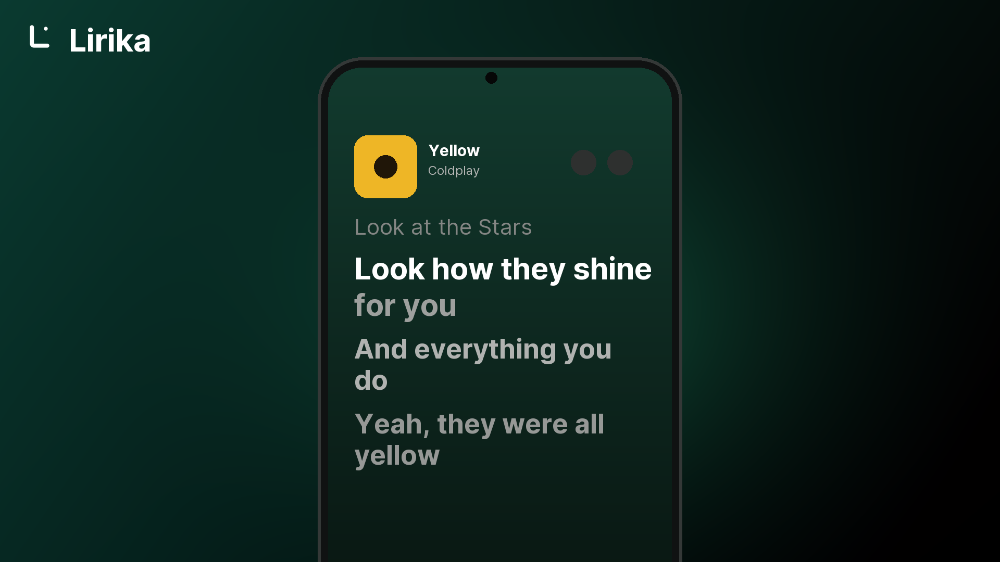

<div align="center">

<br/>
<br/>


# Lirika

### Aesthetic YouTube Music Client

**Derived from [BitChord](https://github.com/kushagrasinghx/BitChord) by Kushagra Singh, modified by Daffa (daffa-789) on 2026-11-17.**

**Desktop only — Windows and Linux, built from this tree.** The phone client has been removed. [What this fork changes](#this-fork).

<br/>

[](LICENSE)

<br/>

[**Build from source**](#download) · [**Features**](#features) · [**This fork**](#this-fork) · [**Contributing**](#contributing) · [**Support**](#support) · [**Disclaimer**](#disclaimer)

<br/>


</div>

> [!IMPORTANT]
> Lirika is not affiliated with, endorsed by, or connected to YouTube or Google in any way. Use it at your own discretion.

---

<div align="center">



<h1><a id="features"></a>Features</h1>

<table>
  <tr>
    <td width="50%" valign="top">

#### Playback
- **Search, browse and play** anything available on YouTube Music.
- **Hi-Res lossless audio** — FLAC/ALAC from an addon server you configure, with YouTube Music as fallback.
- **Gapless playback with true crossfade**, adjustable 0–12s, and an optional blend on a manual skip.
- **Offline downloads** — save tracks with embedded metadata.
- **Local music library** integration.
- **Keeps playing while you work** — OS media keys and the system media overlay, through SMTC on Windows and MPRIS on Linux.
- **Apple-like lyrics animation** — credit to [binimum](https://github.com/binimum/am-lyrics).

#### Connectivity & Accounts
- **Sign in with your Google account** for personalized content. Several logins can be held at
  once, each with its own channels, and any of them can be signed out of again.
- **Spotify integration** — connect your account to play your playlists and Liked Songs.
- **Discord Rich Presence** — in-app login, live track/artist/album and progress.
- **Scrobbling** to Last.fm and ListenBrainz.
- **Pluggable sources** — add, edit, test and health-check addon servers over plain HTTP.

    </td>
    <td width="50%" valign="top">

#### Experience
- **Animated album canvas** — motion artwork on the now-playing screen.
- **Word-synced lyrics** — word/syllable-level highlighting from multiple sources.
- **Lyrics providers** — credit to [lrc.red](https://lrc.red), [BiniLyrics](https://github.com/binimum), [BetterLyrics](https://github.com/better-lyrics/better-lyrics), [PaxSenix](https://lyrics.paxsenix.org), [LyricsPlus](https://github.com/ibratabian17/YouLyPlus), [SimpMusic](https://github.com/maxrave-dev/SimpMusic), [Unison](https://unison.boidu.dev), [Megalobiz](https://www.megalobiz.com), [KuGou](https://www.kugou.com), [LRCLIB](https://lrclib.net), [Musixmatch](https://www.musixmatch.com) and [Genius](https://genius.com).
- **Dynamic, artwork-driven theming** — Material palette extracted from album art.
- **Frosted-glass UI** — Telegram-style translucent bars via Haze, Material 3 theming.
- **Dynamic Island player** — the player that stays with you. A capsule on its own frameless,
  transparent, always-on-top window, out of the taskbar and Alt-Tab, and it never steals focus from
  what you are typing into. It stays on screen whatever is in front of it: it rests as a 380×44
  pill with the cover and the line being sung, and the moment the pointer lands on it, it opens
  into a 680×116 face with the transport, three rolling lyric lines and a scrub row — the window
  grows with the glass, so nothing is ever clipped or left floating in empty space. Click the
  capsule to open Now Playing. Six anchors, drag-to-position that remembers where you put it, an
  optional click-through mode (on Windows, `WS_EX_TRANSPARENT` via JNA, so clicks fall through the
  capsule to whatever is beneath it), a menu whose "Up next" section starts any song in the YouTube
  Music queue without opening the app, and a toggle in the system tray. It only appears once a song
  is loaded. The main window is separate: on Windows it draws its own Fluent caption with a DWM
  backdrop, on Linux the window manager decorates it.

#### Controls & Tweaks
- **Audio quality ceiling** — pick where on the ladder a track starts, from ~64 kbps up to bit-exact lossless.
- **Playback speed control** (0.25×–3.0×) and **skip silence**.
- **Sleep timer** — fixed presets or "stop after this track".
- **System equalizer** integration.
- **Stats for nerds** — codec, bit depth, sample rate, and more on the now-playing screen.

    </td>
  </tr>
</table>

</div>

---

<div align="center">

<h1><a id="download"></a>Download</h1>

<b>What this tree ships</b>

| Platform | Artefact | How it is verified |
| --- | --- | --- |
| Windows 11 | `.msi`, `.exe`, portable `.zip` | compiled on a `windows-latest` runner with the desktop test suite; installers built and launched locally |
| Linux | `.deb`, `.rpm`, `.AppImage` | compiled on `ubuntu-latest`. The `.deb` payload was opened and every one of its 29 shared libraries reads as `x86_64` ELF; the `.rpm` header declares `CPU = x86_64`, `Host OS = linux`. The AppImage is the portable one — it runs from the file, no install. None of the three has been launched on a real Linux desktop |

The desktop client is the Compose-for-JVM app. It runs on Windows 11 (Fluent window frame, Dynamic
Island lyrics, SMTC media keys) and on Linux (MPRIS media controls and the StatusNotifier tray).
Installers for **this** fork appear on the Releases page of this repository, published by the
`Release` workflow whenever a `v*` tag is pushed — each release carries a `SHA256SUMS.txt` manifest
next to the files. Building from source is one clone away:

```bash
# JDK 25 (Temurin) is required and must be what JAVA_HOME points at.
# gradle.properties deliberately does NOT pin org.gradle.java.home — that path only exists on one
# machine, and pinning it breaks the build everywhere else.
./gradlew :desktopApp:run                  # run it
./gradlew :desktopApp:packageExe           # Windows single-file installer
./gradlew :desktopApp:packageMsi           # Windows MSI installer
./gradlew :desktopApp:windowsPortable      # Windows portable zip, no installer needed

# on Linux
./gradlew :desktopApp:packageDeb
./gradlew :desktopApp:packageRpm
# the AppImage is the one format Gradle cannot make; the script wraps the app image
desktopApp/packaging/appimage.sh desktopApp/build/compose/binaries/main/app/Lirika dist/Lirika.AppImage
```

`-Pbitchord.target=linux` picks the Linux native dependencies (FFmpeg/Skiko/JavaFX classifiers)
and the Linux runtime modules, so the Linux side can be assembled and checked from Windows; CI
additionally compiles the same sources natively on `ubuntu-latest` (the `desktop-linux` job), and the
`.deb` / `.rpm` are produced there.

On Windows, `cmake`, `Ninja` and a MinGW C++ compiler on `PATH` add the native window frame and
SMTC media keys; without them the app still builds and runs, just without those two.

What release `v1.8.32` actually published, for reference:

| Output | Size |
| --- | --- |
| `Lirika-1.8.32.msi` / `.exe` | 198 MB each |
| `Lirika-1.8.32-windows-portable.zip` | 160 MB |
| `bitchord_1.8.32_amd64.deb` / `bitchord-1.8.32-1.x86_64.rpm` | 189 MB each |

**Publishing** — a tag is the release: `git tag v1.8.33 && git push origin v1.8.33` runs
[`.github/workflows/release.yml`](.github/workflows/release.yml), which builds the Windows MSI, Exe and
portable zip on a Windows runner and the `.deb` and `.rpm` on a Linux runner, then publishes all of
it as one GitHub Release with a `SHA256SUMS.txt` manifest. The tag's patch number becomes the
installer version code, so the packages a release ships are named after the tag. Check a
download before you install it:

```bash
sha256sum -c SHA256SUMS.txt          # Linux, Git Bash
```

```powershell
Get-Content SHA256SUMS.txt | ForEach-Object {
  $h, $n = $_ -split '\s+', 2
  '{0}: {1}' -f $n, ((Get-FileHash -Algorithm SHA256 $n).Hash.ToLower() -eq $h)
}
```

Public releases deliberately ship no bundled Last.fm API key — a build that baked one in would write it in
plain text into the launcher everyone downloads. Scrobbling works anyway: Settings asks for your own key.

**Publishing token** — the release workflow uses one repository secret, `RELEASE_TOKEN`: a
fine-grained PAT scoped to this repository with `Contents: read+write`. The builds themselves use
the automatic `GITHUB_TOKEN`.

</div>

---

<div align="center">

<h1><a id="this-fork"></a>What this fork changes</h1>

</div>

Two decisions shape this tree: the desktop client is trimmed to be a light player rather than
everything the upstream client could do, and the phone target has been removed entirely — `:shared`
now serves only the JVM modules.

**Out, and why**

| Removed | Why |
| --- | --- |
| Automix / DJ transitions | Out of this tree: `onnxruntime` (51.9 MB), two ONNX models (13.5 MB), the C++ analyser and its native loader, plus background inference on every track. Manual crossfade (0–12 s) and blend-on-skip stayed. The pure-Kotlin transition planner remains in `:shared` because the desktop still uses it for crossfade cues. |
| GraalVM JS module host | `polyglot` + `js-language` + `truffle` + ICU ≈ 61 MB for a plugin index that has no install UI, whose upstream URL 404s and whose preference nothing in the code read. Addon servers still give FLAC/Hi-Res over plain HTTP. |
| Listen Together / PartySync / QR invite | Out of the UI: it needed a third-party server nobody ever filled in, and the button only ever produced "Set the party server address first". A party still needs a server you point at yourself — upstream's `backend/` is not part of this tree. |
| Presence telemetry | A "the app is open" ping to the upstream server every ~5 minutes, with no switch in Settings. Removed. |
| macOS | Out entirely, and the reason cannot be bought around: an unsigned `.dmg` is stopped by Gatekeeper on first launch — *"BitChord is damaged and cannot be opened"* — and the only way past that is notarisation, which needs a paid Apple Developer account. A build nobody can open on the first try is not a release. The Mac *window* code was already out of this tree (Mac frame, traffic-light caption buttons, Dock listener), so what remained to remove was the packaging itself: `packageDmg`, the `macos-15` runner job, and the Apple-side native classifiers. |
| iOS | Cut entirely: no Apple targets in `:shared`, no iOS job in CI, no framework in the release. The players run on AWT + JNA + FFmpeg + WASAPI; moving them to AVFoundation and UIKit is a rewrite. |
| Android | Cut entirely with the phone target: no `:app`, no `:sharedUi`, no AGP, no SDK/NDK requirement, and no APK in releases. The package name `com.music.bitchord` is kept only as an attribution trail. |

**In, and what it costs**

- Windows Fluent caption and DWM backdrop (`bitchord_window.dll`), SMTC media keys (`bitchord_smtc.dll`), both built with CMake + Ninja + MinGW when present.
- Dynamic Island lyrics overlay, its settings page, and a tray entry that toggles it on both platforms.
- A YouTube Music-inspired shell around Lirika's own dark token set: a persistent player dock with
  hover-expanded seek, volume and audio-output controls; restyled Home, Explore, Library and Search;
  a landscape Now Playing; and the island as the out-of-window player.
- `javafx-media` named as a dependency of its own, with the platform classifier. It used to arrive
  only as a transitive of `javafx-web`, without that classifier, so Gradle handed over the empty
  jar: `javafx.scene.web.WebEngine` died in its static initialiser with
  `NoClassDefFoundError: com/sun/media/jfxmedia/events/PlayerStateListener`, on the JavaFX thread,
  where nothing catches it. The in-app sign-in window could never open, the sign-in sat on its
  spinner for ever, and BotGuard never produced a token.
- One native loader (`DesktopNativeRuntime`) shared by the window frame and SMTC, and a portable zip
  task (`windowsPortable`) for machines where an installer is not wanted.
- CI that compiles the Linux sources as well, so the MPRIS / StatusNotifier / ALSA side cannot drift
  out of build (the Linux code itself is deliberately kept).

**Measured effect** — the portable `lib/` went from 310 MB to 191 MB (−38 %), the string catalogues
from 152 KB to 72 KB after deleting the keys nothing referenced, and `:desktopApp:test` runs green. The packaged `Lirika.exe` was launched on this machine to prove the trimmed jlink
runtime is enough for the real app, not just for `:desktopApp:run`.

The working plan, phase by phase, is in [PLAN_WINDOWS.md](PLAN_WINDOWS.md).

---

<div align="center">

<h1><a id="contributing"></a>Contributing</h1>

We welcome contributions to Lirika! Please review our [Contributing Guide](CONTRIBUTING.md) and [Code of Conduct](CODE_OF_CONDUCT.md) before submitting a Pull Request.

[**Contributing Guide**](CONTRIBUTING.md) · [**Code of Conduct**](CODE_OF_CONDUCT.md) · [**Maintainers**](MAINTAINERS.md) · [**Additional Docs**](ADDITIONAL.md)

### Thanks to all contributors ❤

<a href="https://github.com/daffa-789/Lirika/graphs/contributors">
  
</a>

</div>

---

<div align="center">

<h1><a id="support"></a>Support</h1>

Lirika is free and always will be. The original this fork came from is by
[kushagrasinghx](https://github.com/kushagrasinghx) — see their README for their
support links if you want to support the upstream work.

</div>

---

<div align="center">

<h1><a id="disclaimer"></a>Disclaimer & Legal Notice</h1>

Lirika is an independent, community-driven third-party audio player and client. It is **not** associated with Google LLC, YouTube Music, Deezer, Telegram, or any of their parent companies.

* **No Media Hosting:** Lirika does not host, upload, or store copyrighted music files. It operates strictly as an interface to scan local device storage or stream media directly from public, public-facing, or user-authenticated APIs.
* **Fair Use & API Usage:** This software is created solely for personal research, educational, and fair-use purposes. The user is entirely responsible for ensuring their usage aligns with their local copyright laws and YouTube Terms of Service.
* **No Ad-Blocking Guarantee:** While Lirika focuses on providing a clean listening environment, it does not guarantee permanent bypasses or modifications to commercial third-party platform conditions.
* **Copyleft:** Lirika is free software under the GPLv3. The license does not let anyone forbid others from selling or redistributing copies, but any distribution must come with the Corresponding Source under the same license.

</div>

---

<div align="center">

<h1><a id="license"></a>License</h1>

This project is licensed under the **GNU General Public License v3.0 (GPLv3)**. See the [LICENSE](LICENSE) file for details.

**Modification notice (GPLv3 §5a):** Lirika is a modified version of
[BitChord](https://github.com/kushagrasinghx/BitChord) by Kushagra Singh. It was
forked and modified by Daffa (daffa-789) starting 2026-11-17. The upstream
copyright notices remain in the source; this fork's changes are distributed
under the same GPLv3, and source for any binary release is available from this
repository.

</div>
